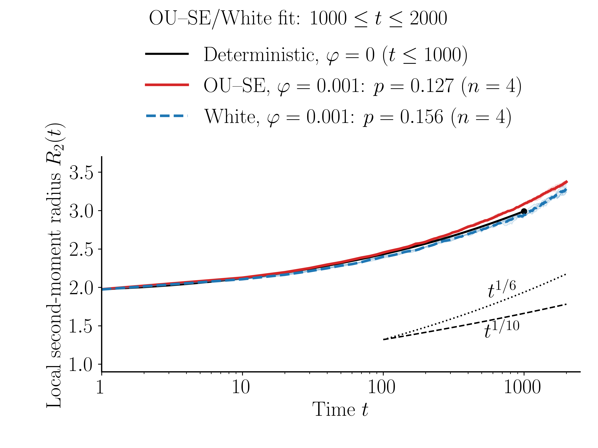
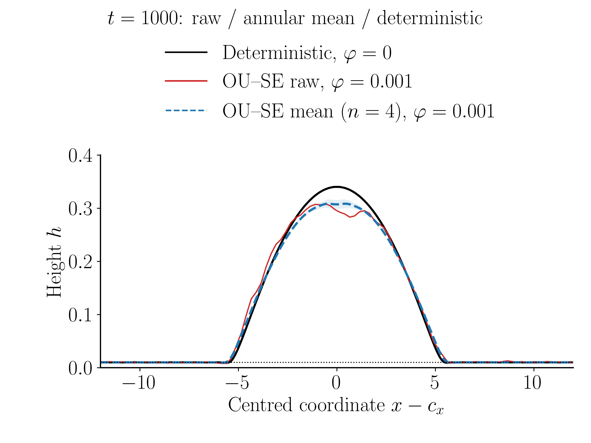
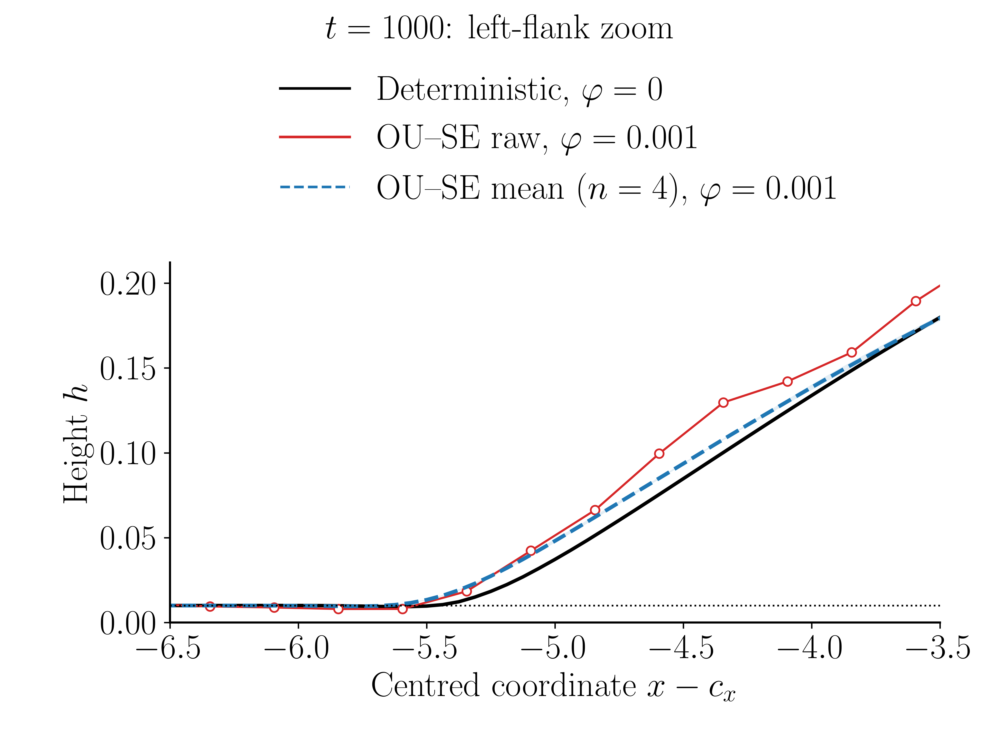

# 液滴半径与截面绘图 notebook

入口：[drop.ipynb](drop.ipynb)。所有绘图代码在此文件内。原场和完整半径时序保留在本地，尚未授权公开；公开仓库的`data/README.md`说明所需文件。GitHub可直接查看预执行图像；重运行时先放入本地数据，路径可配置，不需要集群权限。

## 图

1. [半径 R(t)](figures/01_radius_vs_time.png)：无涨落、OU–SE和白噪声；噪声各4条独立轨迹，均值±样本SD。
2. [三条截面](figures/02_ou_raw_mean_det_section.png)：OU单轨迹原始中心截线、OU环向＋4seed平均、无涨落单场环向轮廓。
3. [三条截面放大](figures/03_ou_raw_mean_det_zoom.png)：同一左侧边缘窗口；原始线保留原生网格点。
4. [触底点同位置截线](figures/04_contact_section_three_modes.png) / [放大](figures/05_contact_section_zoom.png)：无涨落、OU、白噪声三种单场的同一物理y行，不是平均轮廓。
5. [二维9×9网格放大](figures/06_contact_region_three_modes.png)：同一位置，红格表示数值严格阈值。





## 运行

先按[data/README.md](data/README.md)放入本地输入数据；公开仓库不含这些数据。

```bash
python -m pip install -r requirements.txt
# 系统须另有LaTeX、dvipng、dvips；从本目录启动Jupyter，打开drop.ipynb，Run All。
python -m nbconvert --to notebook --execute --inplace drop.ipynb
```

配置单元可改数据目录、单轨迹seed、截面窗口和拟合区间。TeX不在PATH时设置`LATEX_BIN`。图为8×6英寸、20pt、无网格、真LaTeX；PDF和600dpi PNG同时导出。notebook已保存图像输出，可直接在GitHub查看。

## 数据与口径

- 当前原场为t1000，L64、256²、hp=.01、R0=5、cos⁴超额峰高1、A0、无AMR。OU/白噪声varphi=.001，dt=.003125；OU sigma=.25/tau=.01。
- 完成轨迹为OU和白噪声各4条，另外两条模拟前资源检查失败不入统计。无涨落旧参考varphi0、dt=.03125，仅到t1000，不外推、不拟合其1000–2000指数。
- R2为局部环向超额厚度的二阶矩，截止于环均超额峰值1%的首次交点；不是接触线半径。半径CSV来自1616个噪声原场、1001个无涨落原场；每行含原场SHA。
- data/native_fields_t1000.npz含9个未平滑原场，notebook校验容器SHA并重建二进制SHA，重新计算t1000半径核对CSV。
- 平均轮廓先各自居中环向平均，再对4个独立OU seed取均值；带为seed样本SD。原始中心行与理想中心最多差半个网格，实际位置由notebook打印。
- 白噪声使用hp附近的幅度掩膜，OU全场；同幅度参数不等于相同物理噪声响应。单格触底是数值下界事件，不是已证实的物理破裂。有效指数和幂率参考不构成渐近规律或收敛证明。
- 此为已有数据后处理包，未改变或运行仓库内求解器。当前目录的物理/数值参数不等同于上级求解器默认值。

来源、源码SHA和输入校验记录位于本地数据包的metadata.json及manifest.sha256.json；参见[data/README.md](data/README.md)。

## Windows执行环境说明

本次验证使用独立Jupyter内核与官方PyPI pyzmq 27.1.0 wheel，未修改全局Python。当前机器的Conda构建曾在启动内核时报`epoll.cpp:73`；隔离官方同版本wheel后成功。若遇到同类启动问题，优先在独立venv安装PyPI依赖，参见[pyzmq官方修复记录](https://github.com/zeromq/pyzmq/pull/2024)。此为内核运行库问题，与绘图数据无关。

建议在独立虚拟环境运行，避免既有Conda二进制依赖冲突。例如Windows：

```powershell
python -m venv .venv
.venv/Scripts/python -m pip install -r requirements.txt
.venv/Scripts/python -m nbconvert --to notebook --execute --inplace drop.ipynb
```

Linux/macOS将`.venv/Scripts/python`换成`.venv/bin/python`。LaTeX仍须由系统提供。
