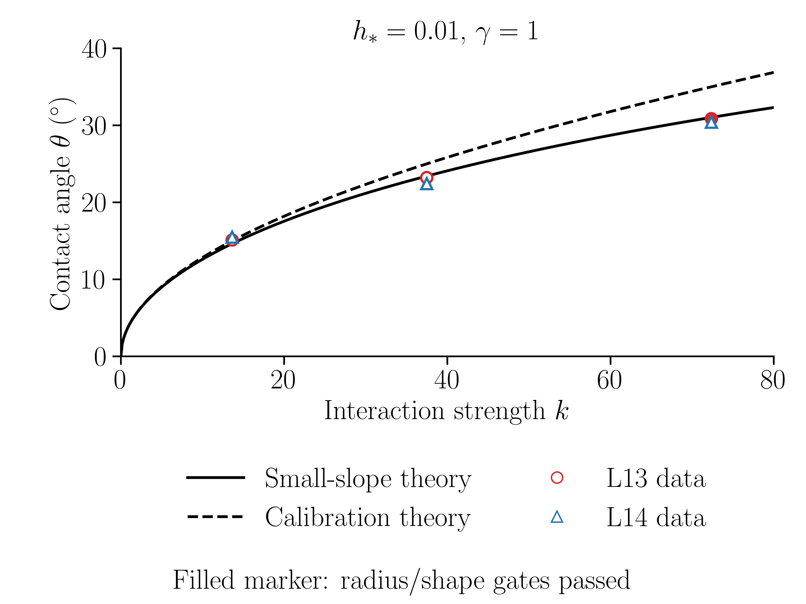
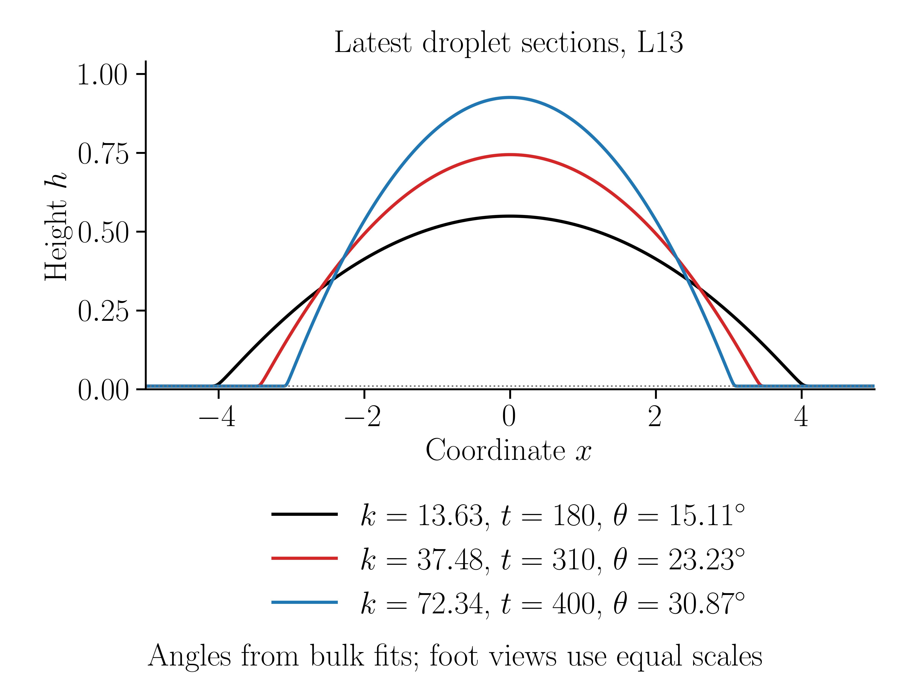

# 无涨落液滴接触角：前驱膜 0.01

这是独立的确定性液滴测试目录，与 `film_rupture/` 的无排斥随机破膜工况不同。本模型保留短程排斥和长程吸引，噪声严格为零，没有滑移；当前构建和验收范围是单进程 OpenMP，未声称通过 MPI 验收。

## 最新结果与公式

- [2026-10-21：k–theta曲线、六组当前角度与标角截面](results/2026-10-21/README.md)：PNG/PDF、CSV/JSON、六组原始截面、参数与诊断摘要。
- [控制方程、两种理论角与测量公式](METHODS.md)：说明 $k$、$A$、排斥/吸引符号、完整曲率标定、小斜率几何角、抛物线外推及AMR体积验收。
- 可复现绘图：`python analysis/plot_published_results.py --output /path/to/new/figures`。只验输入hash和重算六组角度可用 `--check`；依赖见 `analysis/requirements-results.txt`。

本次结果按用户要求展示每组最新完整帧的当前角度。图中实/空心保留原时间门槛状态；各组模型时间不同，不能用这些差异冒充末态网格误差。只有蓝色L13通过原半径/形态时间门槛，压力及末态网格最终验收仍待完成。

## k–theta曲线及数据点

实线为小斜率理论，虚线为原标定关系；实心点已通过原时间稳定门槛，空心点为当前测量。



## L13液滴截面

已标注接触角和各组实际模型时间。



## 方程与参数

采用小斜率曲率、周期二维底面上的高度方程：

```math
\partial_t h=\nabla\cdot(h^3\nabla p),\qquad
p=-\nabla^2h-\Pi(h),\qquad
\Pi(h)=k[(h_*/h)^5-(h_*/h)^3].
```

`h*=0.01`，`gamma=1`，`A=k h*^3`（源码 `COEFF_A`）；压力等价于 `-lap(h)+A/h^3-A*h*^2/h^5`。参数 0.01 是势能最小点，不是每步强制膜厚。初始为 `h=0.01+cos(pi*r/10)^4` (`r<5`)，其余为0.01；周期边长32。

| 颜色 | k | A | 完整曲率标定角 | 小斜率模型几何参考角 |
|---|---:|---:|---:|---:|
| 黑 | 13.62966948 | 1.362966948e-5 | 15° | 14.63068090° |
| 红 | 37.47688519 | 3.747688519e-5 | 25° | 23.40678414° |
| 蓝 | 72.33918228 | 7.233918228e-5 | 35° | 31.02318910° |

完整曲率关系为 `cos(theta)=1-k*h*/4`；小斜率模型得到坡度 `s=sqrt(k*h*/2)`，实际几何角应取 `atan(s)`。输出 `theta_lub_degrees` 是坡度的角度单位表达，不是几何接触角。

生产参数 `dt=0.01, HP001_ADAPT_EVERY=2`。L13/L14 指 **AMR允许的最高层数**，不是全域均匀网格；实际叶网格/最小间距见 `amr_native.csv`。初始超额体积约13.536936818，所有六工况共享同一初场。保守导出N1024不是native分辨率。

## 2026-10-19 缺陷审计

来源为 HP001 恢复修复版，旧源 SHA256 `d80bf828a51dd44870d867d45f617d8f50092cc37ba2dae435c718159d53afde`。

* **活动路径受到同类索引错误影响**：耦合多重网格块松弛器两处上侧面系数 `M.y[1]` 应为 `M.y[0,1]`。本次修复这两处。单下标是x偏移，不能把它当y偏移。
* 随机通量显式y循环的 `f_old[-1]` 同时改为 `f_old[0,-1]`。本工况运行时禁止非零噪声，该路径未参与原有计算；这不等于随机工况已验收。
* 正确的面通量残差计算及非线性物理残差检查一直使用旋转循环/显式y邻居；松弛器错误不等同于修改目标方程，但可改变迭代效率和有限容差解。是否影响已存结果，以实测修复/控制对照为准。
* 仓库 `ee3646d` 的重复 MPI 体积归约在此源中不存在；当前为单进程OpenMP，MPI随机周期边界问题也不作用于本次零噪声测试。
* 保守 `refine_linear + minmod2 / restriction_volume_average` 与物理/修正halo双线性分开；没有高度裁剪、体积归一化或压力平移。

## 构建与重测

需要 Basilisk `qcc`、C/OpenMP 编译器、Basilisk glutils/fb_tiny；服务器回归脚本用Python标准库并已在Python3.6运行。独立几何分析 `analysis/angle_methods.py` 需Python>=3.10（类型注解语法），在本地执行，不是服务器构建依赖。先设置 `BASILISK` 为Basilisk的 `src` 目录；不同站点可能还需设置 `CC99`。不要使用fast-math。

```bash
export PATH="$BASILISK:$PATH"
python3 tests/check_source.py
python3 -m unittest discover -s tests -p test_guards.py -v
sbatch --export=ALL preflight.slurm
# 确认对应 runs/preflight_JOB/PREFLIGHT_PASS 后：
sbatch --export=ALL,PREFLIGHT_ROOT="$PWD/runs/preflight_JOB" six_case_smoke.slurm
# 全六例实际SMOKE_PASS后，原三k/两网格从共同初场重新计算至t400：
sbatch --export=ALL,SMOKE_ROOT="$PWD/runs/six_ARRAY" six_case_long.slurm
# 可选，已有同参数k25/L13 t400原生checkpoint时：
sbatch --export=ALL,ORIGIN=/path/to/existing/k25_L13_t400 restart_compare.slurm
# 已有k25/L14、t100完整checkpoint/meta时，可核查实际L14：
sbatch --export=ALL,ORIGIN=/path/to/existing/k25_L14,RESTART_LEVEL=14,RESTART_START=100,RESTART_TAG=t0100 restart_compare.slurm
```

前置测试包括常膜、小幅正弦解析衰减、非均匀mobility的二维不等波长转置、OpenMP1/8、修复/旧索引控制；六工况真实10步AMR短测另行验收。恢复测试读取真实native步/时间，要求40000→40010，且必须有40000…40009十次真实耦合求解；输入checkpoint与旧目录保持不变。控制源仅在新运行目录生成，不能用于生产。`verification.json` 同时保存源码/二进制/输入checkpoint hash、原生体积、导出积分和残差。

长算编译示例（新建运行目录，不能覆盖短测或旧结果）：

```bash
qcc -disable-dimensions -fopenmp -D_GNU_SOURCE -DCOEFF_A=3.747688519e-5 \
  -DHP001_ADAPT_EVERY=2 -DLOG_EVERY=100 -DRADIUS_EVERY=100 \
  -Wall -O2 -fno-tree-vectorize contact_angle.c -o solver \
  -L"$BASILISK/gl" -lglutils -lfb_tiny -lm
export OMP_NUM_THREADS=8
./solver 2026101201 .01 400 0 1000000000 13
```

最后一个参数是最高AMR层，噪声参数必须0。恢复须提供 `RESTART_FILE` 和原始 `volume_state.txt`；历史漂移不得清零。恢复工作流只对已经过真实短测的同参数checkpoint使用。长算数组最多6×8=48核，48小时是每例墙钟上限，不是稳态预计时间；超时保留checkpoint，不以作业状态宣称物理收敛。

`analysis/angle_methods.py` 保留此前独立的抛物线/圆弧拟合与合成几何自检。单帧输出属于几何诊断；将其称为稳定角前须满足下述验收。用户要求的当前快照散点可先测量并标注时间/状态。`tests/paired_profile_angle.py` 只比较同时间修复/控制的测量敏感性，不授予稳定角资格。

## 验收边界

全史原生体积相对原V0最大漂移 `<1e-8`，单次AMR转移 `<1e-10`，native与保守导出独立补偿积分相对差 `<1e-12`；MG/Picard及质量/压力离散残差 `<=1e-8`。求解器收敛和短测通过均不能证明物理稳态。

主监测包括 native `h>0.011` 全阈值面积等效半径、四向profile首次0.011交点，以及完整场外环/连通分量。连续三个50模型时间窗半径范围/均值各≤0.1%，末50的双profile和完整场变化≤峰超额高度0.1%之后，才测至少3帧四方向主体窗角度。主法为40–80%主体窗抛物线，圆弧/其它窗口作方法偏差对照。末态L13/L14同时间半径差≤0.2%、主角差≤0.2°，并检查body/film实际压力与物理残差；AMR后瞬时高频峰须与持续动力学区分。

旧k25/L13 t400候选23.2386°及其余旧轨迹保留，不能将短测对照或旧候选写成修复后六工况最终结果。前置测试、量化结果与限制见 [validation/README.md](validation/README.md)。本次结果包包含用于复现的原始截面与诊断摘要；完整原生树、二维场和运行日志另存于研究工作区。
