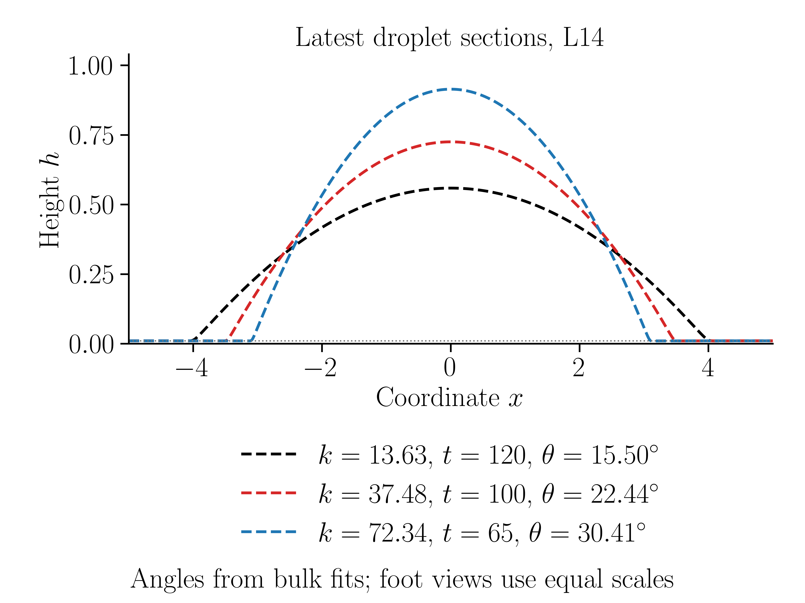
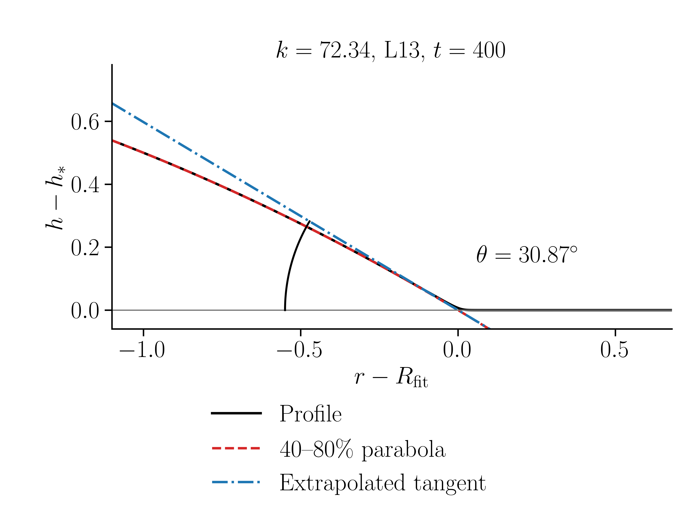

# 2026-10-21：k–theta曲线、当前数值角与液滴截面

修复版无涨落测试，冻结时间 **2026-10-21 12:02:40（北京时间）**。控制方程和完整推导见 [METHODS.md](../../METHODS.md)。六组均从同一初场独立计算，噪声为零；L13/L14是AMR最高层，实际最细层分别达到13/14。

## 结果

| k | 网格 | 完整场模型时间 | 当前几何角 | 小斜率理论角 | 数值−理论 | 时间门槛状态 |
|---:|---|---:|---:|---:|---:|---|
| 13.63 | L13 | 180 | 15.109133° | 14.630681° | +0.478452° | 当前测量点，原时间门槛未过 |
| 13.63 | L14 | 120 | 15.497803° | 14.630681° | +0.867122° | 当前测量点，原时间门槛未过 |
| 37.48 | L13 | 310 | 23.232045° | 23.406784° | -0.174739° | 当前测量点，原时间门槛未过 |
| 37.48 | L14 | 100 | 22.435142° | 23.406784° | -0.971642° | 当前测量点，原时间门槛未过 |
| 72.34 | L13 | 400 | 30.867171° | 31.023189° | -0.156018° | 半径/形态通过，局部准稳态候选 |
| 72.34 | L14 | 65 | 30.411882° | 31.023189° | -0.611307° | 当前测量点，原时间门槛未过 |

数值是每组最新完整帧、四方向40–80%主体抛物线外推几何角的均值。当前散点按用户要求展示；各组模型时间不同。只有k72.34/L13通过原半径/形态时间门槛，主体与膜压力及末态网格最终验收仍未全部通过。不能把这些不同时间的L13/L14差当成最终网格误差。

主曲线与原标定关系分别为：

```math
\theta_{\rm model}=\arctan\sqrt{\frac{k h_*}{2\gamma}},\qquad
\theta_{\rm cal}=\arccos\left(1-\frac{k h_*}{4\gamma}\right),\quad h_*=0.01,\quad\gamma=1.
```

第一条对应程序的小斜率曲率，第二条对应15/25/35°的全曲率标定标签。图中红圆为L13，蓝三角为L14；实心表示原半径/形态时间门槛已通过。误差棒是同帧四方向min/max，极小且通常不可见，不是置信区间或时间不确定性。


## 液滴截面与接触角

完整截面直接来自本目录的原始profile，图例标出k、模型时间和同一测法角度。总览采用独立坐标轴比例；六张局部图以等比例坐标画出外推切线与角弧。




局部图横坐标 $r-R_{\mathrm{fit}}$，纵坐标 $h-h_*$；角弧属于主体拟合外推到前驱膜高度处的切线。$R_{\mathrm{fit}}$不是监控的首次 $h=0.011$ 交点半径。微观膜脚本身是平滑的，图中不假定它存在尖角。



| 工况 | PNG | 矢量PDF |
|---|---|---|
| k_theta | [PNG](figures/k_theta.png) | [PDF](figures/k_theta.pdf) |
| sections_L13 | [PNG](figures/sections_L13.png) | [PDF](figures/sections_L13.pdf) |
| sections_L14 | [PNG](figures/sections_L14.png) | [PDF](figures/sections_L14.pdf) |
| angle_foot_k15_L13 | [PNG](figures/angle_foot_k15_L13.png) | [PDF](figures/angle_foot_k15_L13.pdf) |
| angle_foot_k15_L14 | [PNG](figures/angle_foot_k15_L14.png) | [PDF](figures/angle_foot_k15_L14.pdf) |
| angle_foot_k25_L13 | [PNG](figures/angle_foot_k25_L13.png) | [PDF](figures/angle_foot_k25_L13.pdf) |
| angle_foot_k25_L14 | [PNG](figures/angle_foot_k25_L14.png) | [PDF](figures/angle_foot_k25_L14.pdf) |
| angle_foot_k35_L13 | [PNG](figures/angle_foot_k35_L13.png) | [PDF](figures/angle_foot_k35_L13.pdf) |
| angle_foot_k35_L14 | [PNG](figures/angle_foot_k35_L14.png) | [PDF](figures/angle_foot_k35_L14.pdf) |

## 数据与复现

- [k_theta_data.csv](k_theta_data.csv)：六组数值与理论角、时间、差值、原门槛状态。
- [k_theta_data.json](k_theta_data.json)：四方向、三个主体窗口、抛物线/圆弧的完整拟合参数。
- [snapshots.json](snapshots.json)、[profiles/](profiles/)、[snapshots/](snapshots/)：六组未经重采样的原始截面、闭合输出元数据及hash。截面来自原生树采样；其点数不代表原生叶网格分辨率。
- [diagnostics.json](diagnostics.json)：原生总体积、累计/AMR漂移、实际膜厚、压力、物理RHS、半径历史及时间门槛证据。
- [provenance.json](provenance.json)、[sha256.json](sha256.json)：修复源码身份、参数、作业与输入/图像完整性。
- [visual_checks.json](visual_checks.json)、[validation.json](validation.json)：图像及本次发布验证。

在 `droplet_contact_angle/` 内执行（分析不需要SSH或Basilisk）：

```bash
python -m pip install -r analysis/requirements-results.txt
python analysis/plot_published_results.py --check
python -m unittest discover -s tests -p "test_*.py" -v
# 需要系统中有真实LaTeX、dvipng、dvips；不回退到mathtext。输出必须是新目录：
python analysis/plot_published_results.py --output /path/to/new/figures
```

相对路径根据脚本位置解析，未使用研究机器的绝对路径。脚本复用现有 `analysis/angle_methods.py`，先核对hash并从原始profile重算全部六点，再生成九组8×6英寸、20pt、600dpi PNG/矢量PDF。默认缓存放在输出目录的父目录，也可通过MPLCONFIGDIR/TEXMFVAR指定。不会提交、取消或重启计算作业。

## 守恒与状态

原生初始总体积约23.776936818258157；全史最大相对漂移 **8.83163e-10**（门槛1e-8）、单次AMR最大转移 **1.987116e-12**（门槛1e-10）。独立原生树与保守场积分核验已通过。没有高度裁剪、体积归一化或压力平移。完整原生树、二维场及日志在研究工作区保留，本结果包提供可直接重测角度的原始截面和已审计诊断摘要。

| 工况 | 原生总体积 | 最大相对漂移 | 实际膜厚mean [min,max] | 主体/膜压力 |
|---|---:|---:|---|---|
| k15_L13 | 23.77693681363752 | 1.945736e-10 | 0.01007202 [0.01000600, 0.01020088] | 0.1342777 / 0.1857753 |
| k15_L14 | 23.77693681375346 | 1.913689e-10 | 0.01006252 [0.01000107, 0.01027258] | 0.1384445 / 0.1590524 |
| k25_L13 | 23.77693681749460 | 1.562e-10 | 0.01009449 [0.01006507, 0.01011651] | 0.2511138 / 0.6779984 |
| k25_L14 | 23.77693681706656 | 5.530411e-11 | 0.01012176 [0.01001992, 0.01030989] | 0.2400753 / 0.8420884 |
| k35_L13 | 23.77693683879322 | 8.83163e-10 | 0.01006804 [0.01006403, 0.01007098] | 0.3902893 / 0.9548514 |
| k35_L14 | 23.77693681864439 | 3.785517e-11 | 0.01014338 [0.01003215, 0.01033762] | 0.3821062 / 1.900467 |

实际膜厚ROI为5<r<7且h<0.011；h*=0.01是势能参数，不是每步强制实际膜厚。压力/RHS来自AMR后采样，历史峰不能单独宣布物理失稳或稳态。数值残差小、到t400或COMPLETED不等于全域Young平衡。最终同时间L13/L14及时间步验收尚未完成；当前物理/网格验收状态为pending。

源码为 [contact_angle.c](../../contact_angle.c)，SHA256 `7ebff6509708e96af9afd0d9bf4eb9cfe636db827b7fc64cc9b2ff25fb8982e3`，与2026-10-19已运行修复版完全一致。本次新增结果和分析文档，没有改动求解器。
